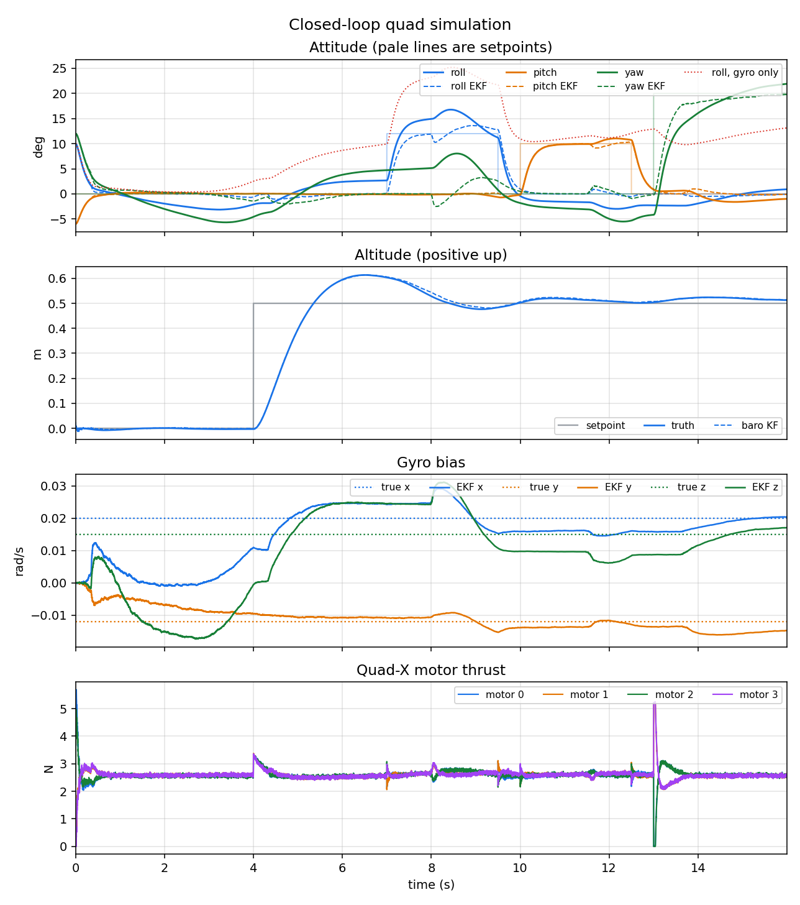
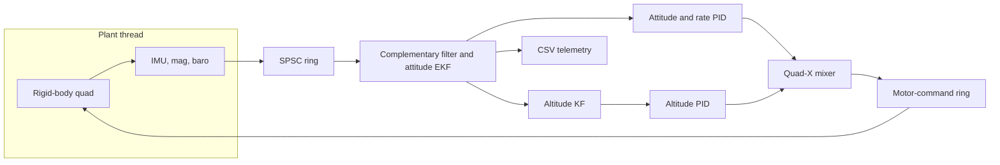

# Flight control demo

A small C++20 quadrotor flight-control library and simulator, written as a public portfolio project by Arpan Bom ([applycoding](https://github.com/applycoding)). It is a software demo. It is not flight software, it has no hardware drivers, and it must not be put on a real aircraft.

The library is the classical inner stack: cascaded attitude and rate PID, a Quad-X mixer, a complementary filter, and an error-state extended Kalman filter, closed around a rigid-body quad with a noisy IMU. A fixed-rate loop moves samples between a sensor thread and a control thread through a lock-free ring.



The figure is the default `fc_sim_demo` run (seeded sensor noise, constant gyro bias). Solid lines are truth, dashed lines are the EKF, pale lines are setpoints, and the dotted roll trace integrates the raw gyro with no bias correction. The complementary filter is in the same run and is written to the CSV (`roll_comp_deg` and the matching pitch and yaw columns); it is left off the figure so the EKF comparison stays readable. The vehicle starts tilted, levels, climbs half a metre, then tracks roll, pitch, and yaw steps. Horizontal position is not controlled, so a tilt still produces a translating trajectory. That is expected.

## Features

- PID with output limits, back-calculation anti-windup, and a first-order filter on the derivative of the measurement
- Cascaded attitude loop: proportional angle command into a rate PID, plus an altitude PID around hover thrust
- Quad-X mixer that keeps collective thrust and scales torque down when a motor would saturate
- Quaternion attitude (body FRD to world NED), including shortest-path error
- Explicit complementary filter (gyro integration, accelerometer and magnetometer feedback)
- Error-state EKF for attitude and gyro bias, with accelerometer and magnetometer updates
- Separate vertical Kalman filter using specific force as an input and barometer as the measurement
- Accelerometer updates are gated. On a free-flying quad the accelerometer measures thrust, so it is only a gravity reference when linear acceleration is small
- Single-producer single-consumer ring and a fixed-rate pacer between a sensor thread and a control thread
- Rigid-body simulator: diagonal inertia, quadratic drag, per-motor thrust and reaction torque, seeded Gaussian IMU noise
- CSV telemetry and `scripts/plot_telemetry.py`

## Architecture



World frame is NED. Body frame is forward-right-down. Motor 0 is front-right and spins clockwise when viewed from above; 1 rear-right CCW; 2 rear-left CW; 3 front-left CCW.

## Build

CMake 3.25 or newer, a C++20 compiler, and Ninja. GoogleTest is fetched at configure time.

```bash
cmake --preset debug
cmake --build --preset debug
ctest --preset debug --output-on-failure
```

Other presets: `release`, and `sanitizers` (AddressSanitizer and UndefinedBehaviorSanitizer). CI presets `ci-gcc`, `ci-clang`, `ci-gcc-asan`, and `ci-clang-asan` pin the compiler the way GitHub Actions does.

Run the closed-loop demo and plot it:

```bash
./build/debug/fc_sim_demo --output telemetry.csv
python3 scripts/plot_telemetry.py telemetry.csv --output docs/closed_loop.png
```

`--no-noise` repeats the deterministic case the unit test checks. `--duration` changes the length. The plot script needs matplotlib (`scripts/requirements.txt`).

## Tests

`fc_tests` covers quaternion and matrix math, PID anti-windup and derivative filtering, mixer allocation against the rigid-body wrench, controller sign, complementary-filter and EKF convergence on a static bench IMU (including gyro bias), rejection of an inconsistent accelerometer once the filter is aligned, the altitude filter, the ring buffer under a second thread, hover and torque signs in the simulator, and the full closed loop. A short threaded hover checks that the rings actually move samples.

## Layout

| Path | Role |
| --- | --- |
| `include/fc` | Public headers |
| `src` | Library sources |
| `apps/sim_demo.cpp` | Closed-loop demo |
| `tests` | GoogleTest |
| `scripts/plot_telemetry.py` | Telemetry plot |
| `.clang-format`, `.clang-tidy` | Local lint config |
| `.github/workflows/ci.yml` | GCC and Clang, with and without sanitizers |

## Honest limits

This is a learning and portfolio model of the inner loops, not a navigation stack.

- No airframe identification, motor lag, propwash, blade flapping, or flexible modes. Thrust is instantaneous.
- No GPS, optical flow, or position controller. The quad will translate when it tilts. Drag is a single quadratic term, sized so a short sim stays bounded.
- The attitude EKF's accelerometer model assumes near-zero linear acceleration. Updates that disagree with that model are skipped, and tilt during a hard push is carried by the gyro and the magnetometer. Bias observability is weak while the accelerometer is gated.
- Gains are hand-tuned for the one simulated vehicle in `VehicleParams`. They are not a tuning guide for hardware.
- The real-time loop sleeps on the wall clock. It is not a certified scheduler and it does not claim hard deadlines.

## License

[MIT](LICENSE). Copyright (c) 2026 Arpan Bom.
